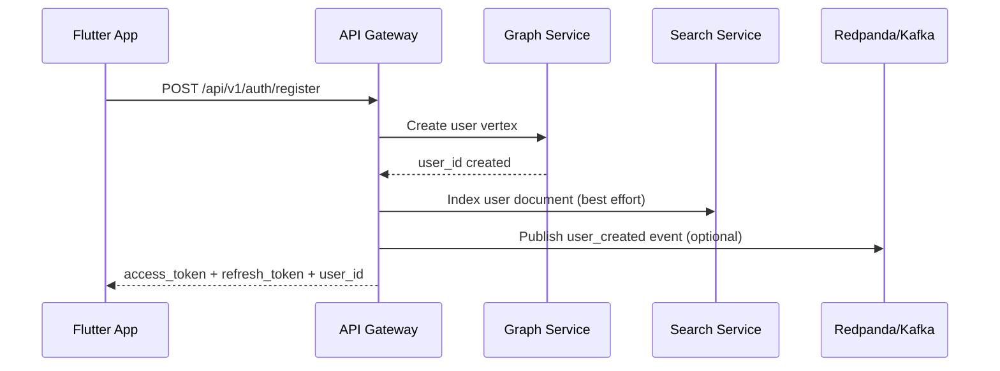
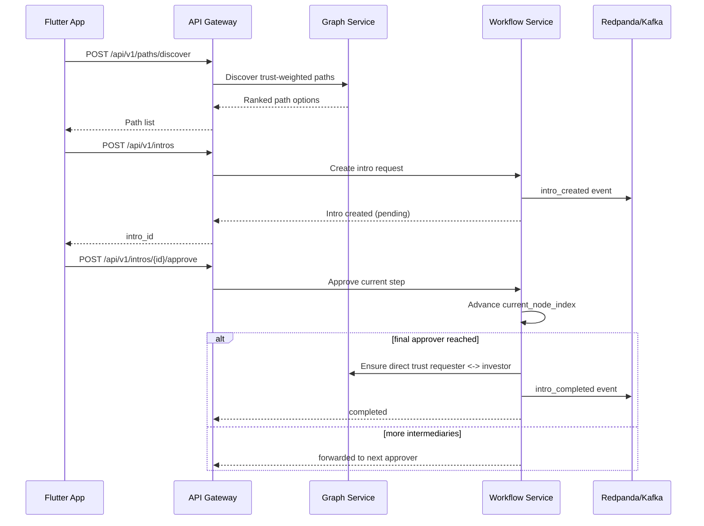
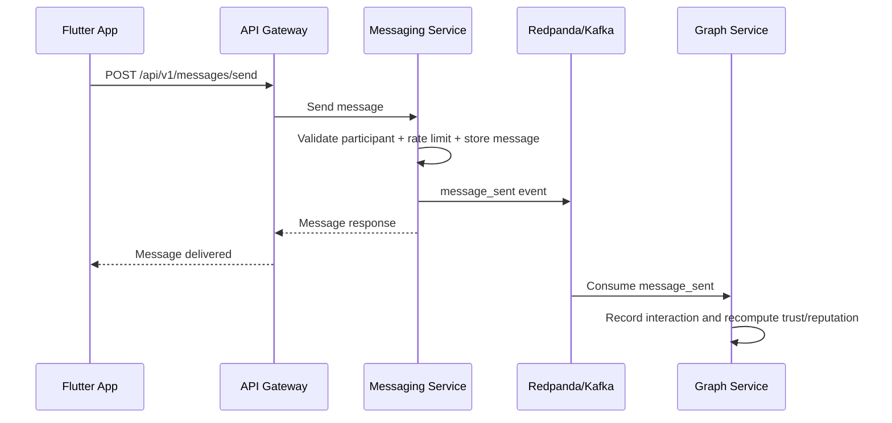
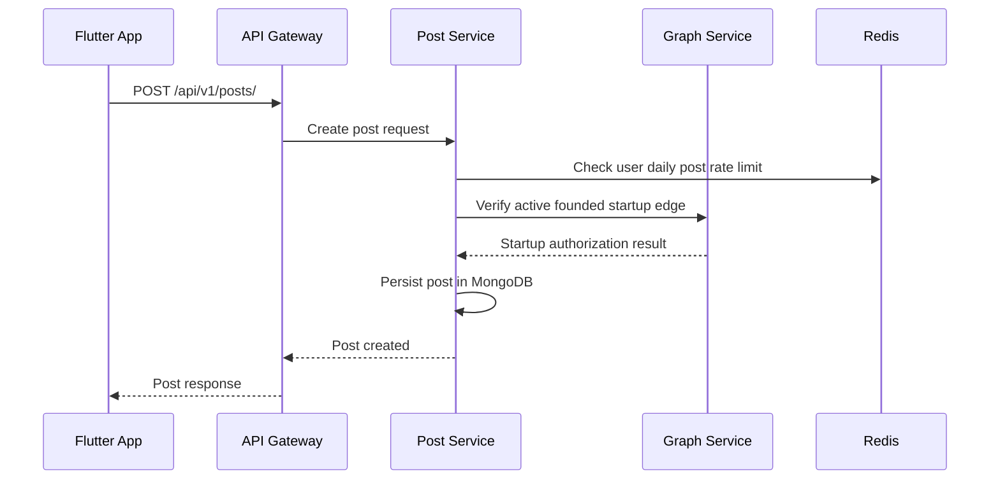

# TrustGraph Platform In-Depth Technical Report

## 1. Problem Statement

Startup fundraising and partnership outcomes often depend on trust and warm introductions rather than cold outreach. Existing professional networking tools are optimized for broad visibility and messaging volume, but they do not model directional trust, introduction chain quality, or intermediary accountability.

TrustGraph addresses this gap by building a trust-weighted relationship graph where:
- Founders, investors, and connectors are represented as network entities.
- Introduction paths are discovered through explicit trust links.
- Intro workflows are approved step-by-step by intermediaries.
- Relationship quality evolves over time through interactions and outcomes.

## 2. Objectives And Scope

### 2.1 Primary Objectives
- Replace cold outreach with high-quality warm introductions.
- Quantify relationship credibility using directional trust and reputation scoring.
- Provide transparent workflow execution for intro approvals.
- Support communication and follow-up inside the same platform.
- Enable discovery through graph-aware search and relevance ranking.

### 2.2 In-Scope Capabilities
- User identity and role-based onboarding.
- Trust connection management (request, accept, reject, remove).
- Distrust reporting and vouching guardrails.
- Intro path discovery with trust-weighted scoring.
- Intro workflow lifecycle and completion automation.
- Real-time encrypted messaging and presence.
- Founder-authorized startup posts with social engagement.
- Search and autocomplete for users and startups.

### 2.3 Out-Of-Scope For Current Version
- Full production-grade moderation console.
- Multi-region deployment orchestration.
- Advanced ML ranking pipeline beyond rule-based scoring.
- End-to-end encrypted key exchange protocol lifecycle automation.

## 3. System Architecture

## 3.1 High-Level Architecture

TrustGraph follows a microservices architecture with one API gateway and five domain services. Data storage is polyglot and aligned with workload patterns.

- Frontend: Flutter app.
- Edge/API: API Gateway.
- Core domains: Graph Service, Workflow Service, Search Service, Messaging Service, Post Service.
- Infra dependencies: JanusGraph, Cassandra, MongoDB, Elasticsearch, Redis, Redpanda (Kafka API).

## 3.2 Service Catalog

### API Gateway (Port 8000)
- Single entry point for frontend clients.
- Proxies requests to domain services.
- Hosts auth endpoints and aggregate health checks.
- Normalizes route surface for client simplicity.

### Graph Service (Port 8001)
- Core trust network engine.
- Manages graph vertices and edges.
- Calculates trust, distrust effects, reputation, centrality, and EigenTrust ranks.
- Discovers intro paths up to configured hop constraints.
- Runs scheduled score decay and refresh jobs.

### Workflow Service (Port 8002)
- Intro request orchestration state machine.
- Manages approval chain progression by intermediary index.
- Emits intro lifecycle events.
- On completion, ensures direct trust connection between requester and investor.

### Search Service (Port 8003)
- Full-text search and filtering over indexed entities.
- User and startup discovery endpoints.
- Optional graph-aware reranking using path proximity.
- Supports indexing endpoints and event-driven indexing consumers.

### Messaging Service (Port 8004)
- Direct messaging with REST and WebSocket APIs.
- Stores encrypted message payloads and metadata.
- Tracks presence, typing, delivery buffering, and read receipts.
- Enforces rate limits and participant authorization checks.
- Publishes messaging events for downstream trust updates.

### Post Service (Port 8005)
- Startup update feed for authenticated users.
- Founder-authorization checks through graph service.
- Supports post CRUD, likes, and comments.
- Uses rate limiting to prevent abuse.

## 3.3 Shared Components

- JWT auth utilities and user identity extraction dependencies.
- Common Kafka producer and consumer abstractions.
- Shared error handling and structured logging helpers.

## 4. Data Architecture And Ownership

## 4.1 Storage Mapping

- JanusGraph (+ Cassandra + Elasticsearch backend):
  - Graph entities, trust relations, distrust and vouch edges.
  - Path traversal and trust analytics.

- MongoDB:
  - Intro workflow documents.
  - Messaging conversation metadata, block lists, key metadata.
  - Post, like, and comment documents.

- Cassandra:
  - Time-series style message payload persistence by conversation.

- Elasticsearch:
  - Search indices for users, startups, organizations.

- Redis:
  - Cache patterns, presence and typing keys, pubsub fanout, rate limits.

- Redpanda/Kafka:
  - Event backbone across intro, trust, user, and messaging domains.

## 4.2 Data Ownership Principles

- Graph Service owns trust semantics and relationship-state truth.
- Workflow Service owns intro workflow truth and approval history.
- Messaging Service owns message transport and message persistence.
- Post Service owns feed content lifecycle.
- Search Service owns query-time retrieval model and index projections.

## 5. Core Business Logic

## 5.1 Trust Semantics

- Trust is directional and represented as edge properties.
- Trust score is computed from interaction count, successful intro count, and recency.
- Distrust edges can override trust in effective score resolution.
- Vouch edges act as positive governance signals, bounded by guardrails.

## 5.2 Intro Path Discovery

Path scoring emphasizes relationship quality and path reliability.

Core factors:
- Trust score.
- Relationship strength score.
- Recency score.
- Mutual trust boost.
- Hop-count penalty.

Filtering constraints include:
- Maximum hops.
- Minimum trust threshold.
- Path exclusion based on active distrust conditions.

## 5.3 Workflow State Model

Main states:
- pending
- approved
- declined
- completed
- failed

Rules:
- Only the currently expected intermediary can approve or decline.
- Approval increments the current path index.
- Final approval marks completion and triggers completion side effects.

## 6. Sequence Diagrams

## 6.1 Registration And User Indexing

## 6.2 Intro Discovery And Approval Chain

## 6.3 Messaging Event Feedback Into Trust Scoring

## 6.4 Founder-Authorized Post Creation

## 7. API Surface Summary

The gateway exposes a unified API surface that proxies downstream services:
- Auth: register, login, refresh, me.
- Users and graph edges: trust, distrust, vouch, reputation, connection state.
- Paths: intro path discovery.
- Intros: create, list, pending approvals, approve, decline, complete.
- Search: user search and related discovery operations.
- Messaging: messages, conversations, read receipts, typing, image transfer.
- Posts: feed, post CRUD, likes, comments.

## 8. Security And Trust Governance

## 8.1 Access Control
- JWT bearer authentication at API level.
- Shared current-user extraction and role dependency checks.
- Resource-level authorization for critical operations.

## 8.2 Governance Controls
- Distrust reporting requires guardrail checks.
- Vouching uses bounded limits and conflict prevention logic.
- Workflow approval enforces strict current-approver validation.

## 8.3 Abuse Prevention
- Per-user rate limits for messaging and posting.
- Message payload size limits.
- Founder-only posting authorization for startup updates.

## 9. Reliability And Operations

## 9.1 Runtime Characteristics
- Service startup and shutdown lifecycle hooks.
- Health checks per service plus gateway aggregate health.
- Background jobs for trust decay and storage cleanup.
- Event-driven eventual consistency between bounded contexts.

## 9.2 Deployment Model
- Local and dev orchestration via Docker Compose.
- Healthcheck-driven startup dependencies.
- Per-service environment variable configuration.

## 9.3 Observability
- Structured and service-specific logging patterns.
- Health endpoint monitoring.
- Kafka topics support asynchronous processing and replay-friendly integration.

## 10. Evaluation Metrics Framework

## 10.1 Product Effectiveness Metrics
- Intro acceptance rate:
  - Accepted intro requests / total intro requests.
- Intro completion rate:
  - Completed intro requests / approved intro requests.
- Median time-to-intro:
  - Median time from intro creation to completion.
- Warm path quality score:
  - Average discovered path_score among accepted paths.

## 10.2 Trust Model Metrics
- Trust uplift after interaction:
  - Mean delta trust_score after valid message events.
- Reputation stability index:
  - Variance in reputation_score over rolling time windows.
- Distrust dispute ratio:
  - Disputed distrust reports / total active distrust reports.
- Vouch-to-distrust ratio:
  - Active vouches / active distrust reports per cohort.

## 10.3 Search And Discovery Metrics
- Search click-through rate:
  - Clicked results / search result impressions.
- Discovery-to-intro conversion:
  - Intro requests initiated from search results / searched sessions.
- Proximity rerank gain:
  - Improvement in downstream conversion between reranked and baseline results.

## 10.4 Messaging And Engagement Metrics
- Messages per active conversation per day.
- Read receipt latency (p50, p95).
- Presence accuracy rate.
- Reconnect success rate for WebSocket sessions.

## 10.5 Platform Reliability Metrics
- Endpoint availability by service (SLO).
- p95 and p99 latency by endpoint family.
- Error budget burn rate.
- Consumer lag and event processing delay.
- Data consistency lag between source-of-truth and search index.

## 10.6 Suggested Initial Target Bands

- Gateway uptime: >= 99.5% in controlled staging.
- p95 API latency for critical read paths: <= 500 ms.
- Intro completion rate after first approval: >= 60% baseline target.
- Message send success: >= 99.0%.
- Search response p95: <= 400 ms for common queries.

## 11. Testing And Validation Strategy

## 11.1 Functional Validation
- Contract tests for gateway-to-service proxies.
- Integration tests for trust edge lifecycle.
- Workflow state-transition correctness tests.
- Messaging flow tests for send, read, typing, and presence.
- Post authorization tests for founder constraints.

## 11.2 Non-Functional Validation
- Load tests for search and messaging endpoints.
- Soak tests for WebSocket connection stability.
- Event consumer lag and replay behavior validation.
- Chaos tests for dependency degradation handling.

## 12. Risks, Constraints, And Improvement Areas

- Cross-service schema drift risk across event payloads.
- Eventual consistency windows between source writes and searchable index updates.
- Potential operational complexity from polyglot persistence.
- Need for stronger moderation tooling around distrust/vouch disputes.
- Opportunity to add ML-assisted ranking and intro outcome prediction.

## 13. Conclusion

TrustGraph is a trust-intelligence platform that combines graph analytics, workflow orchestration, communication, and content sharing into a single startup networking product. Its architecture aligns service boundaries with domain responsibilities and uses both synchronous APIs and asynchronous events to maintain a scalable, evolvable system. The provided metrics framework enables rigorous technical and product evaluation as the platform moves from development to production maturity.
